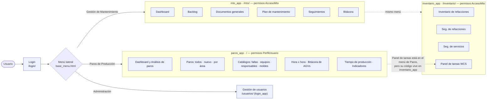
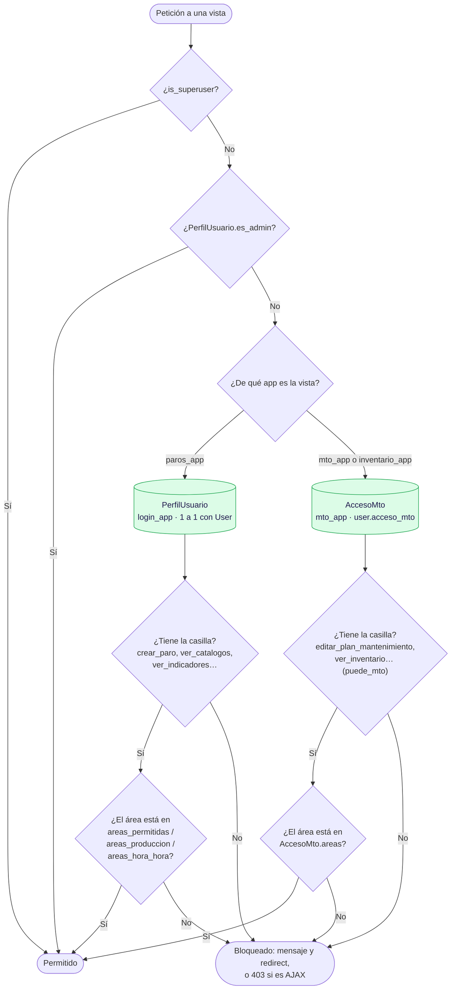
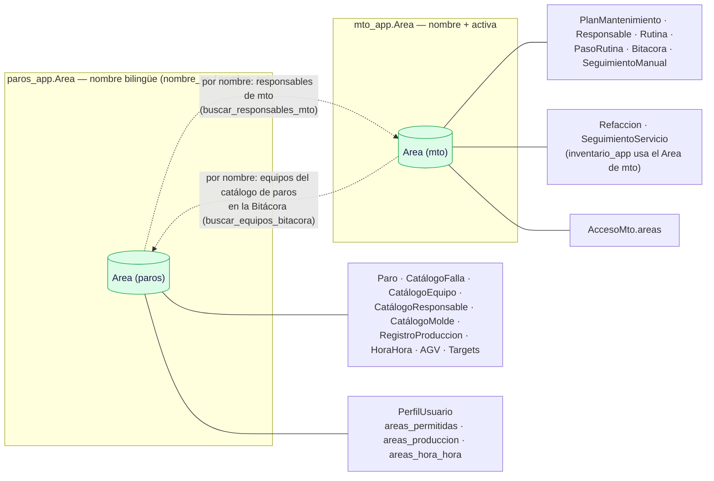

# 0 · Mapa general

**Qué es:** la vista de conjunto de STOPLINE — qué apps hay, qué pantallas tiene cada módulo del menú,
cómo se decide quién puede hacer qué y cómo se relacionan las áreas.
**Quién lo usa:** todos los usuarios con sesión; el menú lateral muestra un módulo a la vez
(**Gestión de Mantenimiento** o **Paros de Producción**).
**Archivos:** `paros_project/urls.py`, `*/urls.py`, `*/models.py`, `login_app/permisos.py`,
`login_app/signals.py`, `menu_app/templates/menu_app/base_menu.html`.
**Revisado:** 2026-11-08 — URLs, modelos y menú de las 5 apps.

## Diagrama 1 · Apps y pantallas del menú

## Diagrama 2 · Cómo se decide un permiso

Hay **dos perfiles de permisos independientes** por usuario. Mezclarlos es una fuente común de errores.

## Diagrama 3 · Las dos tablas de áreas

El proyecto tiene **dos modelos `Area` distintos**, sin llave entre ellos. Donde un módulo necesita datos del
otro, los empata **por nombre** (sin distinguir mayúsculas).

## Notas

- **URLs:** `paros_app` y `login_app` no tienen prefijo (`/paros/`, `/catalogos/…`, `/login/`); `mto_app` vive en
  `/mto/` e `inventario_app` en `/inventario/`. Espacios de nombres: `paros:`, `mto:`, `inventario:`.
- **Superusuario y administrador** (`es_admin`) pasan todos los permisos y todas las áreas, en las dos apps
  (`login_app/permisos.py → puede_mto`).
- **`AccesoMto` gobierna también Inventario**, aunque sea otra app (`ver_inventario`, `editar_inventario`,
  seguimientos de refacciones y servicios).
- **Al crear un usuario** se crea su `PerfilUsuario` automáticamente (`login_app/signals.py`); si es superusuario
  queda con `es_admin = True`.
- **Áreas por nombre:** si un área se llama distinto en *Paros* y en *Mantenimiento* (aunque sea por un acento),
  la Bitácora no encuentra sus equipos: muestra el aviso *"El área «X» no tiene catálogo de equipos en Paros"* y deja
  escribir el equipo a mano. En el admin, las columnas **¿Existe en Paros?** / **¿Existe en Mantenimiento?** muestran
  qué áreas no tienen pareja. La comparación ignora mayúsculas y revisa el nombre en español y en inglés.
- **Panel de tareas (WCS):** aparece en el menú de *Paros de Producción*, pero su vista y sus permisos están en
  `inventario_app` (`/inventario/wcs/`).

## Hallazgos de la revisión

| # | Dónde | Qué pasa | Estado |
|---|---|---|---|
| 1 | `CLAUDE.md` › "Area is the cross-app anchor" | Dice que `Area` vive en `paros_app` y que mto e inventario la usan; en realidad `mto_app` e `inventario_app` usan **su propio** `mto_app.Area`. | Por corregir el texto |
| 2 | `login_app/signals.py:14-23` | Al crear un superusuario asigna casillas que **no existen** en `PerfilUsuario` (`ver_paros`, `eliminar_paro`, `ver_catalogo_fallas`, `importar_fallas`…). No da error ni efecto; lo único que funciona es `es_admin = True`. | Por revisar en el módulo 5 |
| 3 | Áreas empatadas por nombre | Frágil: un nombre distinto entre las dos tablas rompe la relación sin avisar. En `buscar_equipos_bitacora` es peor: si no hay coincidencia, **no filtra** y el autocompletado de Equipo de la Bitácora ofrece equipos **de todas las áreas**. Además, `paros_app.Area.nombre` es bilingüe (modeltranslation), así que con la app en inglés compara contra `nombre_en` (confirmado en prueba). | ✅ Corregido 2026-11-08: `mto_app.Area.area_paros()` compara `nombre_es` y `nombre_en`; sin pareja la Bitácora no ofrece equipos y muestra un aviso; el admin de las dos apps tiene la columna ✓/✗ y Mantenimiento avisa al guardar. Probado (servidor y navegador). |
| 5 | Todas las subidas de fotos | Solo revisaban el tipo que declara el navegador (o nada): se podía subir un `.html` disfrazado y quedaba publicado en `/media/`. | ✅ Corregido 2026-11-08: las 9 subidas usan `paros_app.models.imagen_subida_valida()` (contenido real JPG/PNG y nombre nuevo). Los formularios ignoran los archivos que no sirven con un aviso; los modales y el AJAX responden con error. Los **documentos** de Documentación General (`FileField`) no se tocaron: aceptan cualquier archivo a propósito; revisar en su módulo. |
| 4 | `buscar_responsables_mto` | El empate por nombre solo corre si llega `area_id`, pero sus dos usos (`plan_seguimiento_form.js`, `paros_app/autocomplete.js`) no lo mandan: siempre busca en todas las áreas. | Por revisar en los módulos 2 y 4 |
