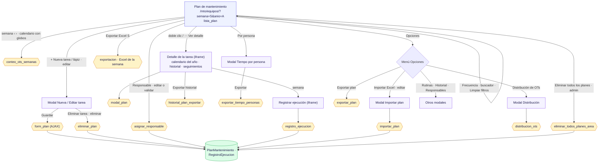
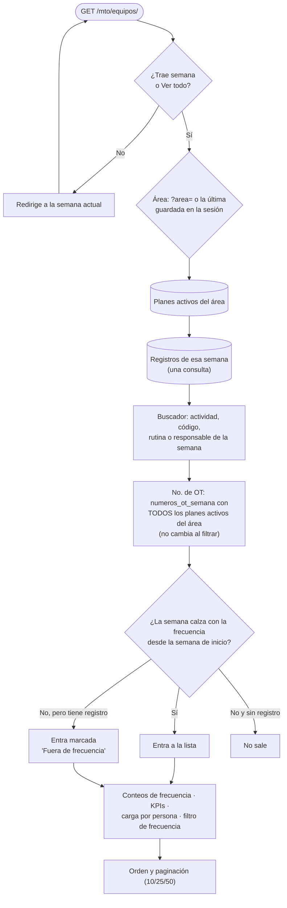

# 1 · Plan de mantenimiento

**Qué es:** la lista semanal de tareas preventivas por área: qué OTs tocan en la semana elegida, quién las hace,
su avance, y desde ahí crear/editar tareas, registrar la ejecución, importar/exportar y ver indicadores.
**Quién lo usa y con qué permiso (AccesoMto):** `ver_plan_mantenimiento` para entrar; `editar_…` para tareas,
importar y asignar; `llenar_…` / `validar_…` para registrar y validar; `eliminar_…` para borrar; *Eliminar todos los
planes* solo superusuario o administrador.
**Archivos:** `mto_app/views/planes.py` (lista, tareas, detalle, exportaciones y datos de los modales),
`planes_importar.py`, `registro_ejecucion.py`, `exportacion.py` (Excel de la semana);
`templates/mto_app/plan/lista.html` (escritorio y celular), `form.html`, `importar.html`, `modal_calendario.html`,
`registro_form.html`, `_distribucion_ots.html`; JS `plan_escritorio.js`, `plan_movil.js`, `plan_tarea.js`,
`plan_importar.js`, `modal_calendario.js`, `registro_form.js`, `distribucion_ots.js`.
**Revisado:** 2026-11-08 — `planes.py` completo.

## Diagrama 1 · Pantallas y acciones (escritorio)

## Diagrama 2 · Cómo se arma la lista de una semana (`lista_plan`)

## Notas

- **Las OTs no se guardan:** se calculan con la frecuencia (`INTERVALO`, en semanas) desde la semana de inicio.
  Un registro solo existe cuando alguien llena, asigna o valida esa semana.
- **Celular:** misma URL; `plan_movil.js` pide el detalle a `plan_detalle_json` y guarda con `registro_ejecucion`
  y `asignar_responsable`.
- **Área recordada:** la última área elegida se guarda en la sesión (`lista_plan_area_id`) y la usan también las
  exportaciones y los modales de datos cuando no reciben `?area=`.
- **Eliminar una tarea** borra en cascada sus registros de ejecución, sus fotos y sus seguimientos de OT; la
  confirmación muestra cuánto historial se va a perder. Para conservarlo, desactivar la tarea (interruptor *Activa*).

## Hallazgos de la revisión

| # | Gravedad | Qué pasa | Estado |
|---|---|---|---|
| 1 | Media | El área no se valida: con `?area=` (o sin área) se ven y exportan planes de cualquier área en la lista, Exportar plan, globos del calendario, Distribución y Tiempo por persona. | ✅ 2026-11-08: `utils.area_del_plan()` (área pedida solo si es del usuario; si no, su primera área; nunca todas mezcladas) en las 5 vistas. Probado. |
| 2 | Media | Detalle de la tarea, Exportar historial y el detalle del celular no piden permiso ni área: cualquier usuario con sesión los abre por id. | ✅ 2026-11-08: `utils.puede_ver_plan()` (permiso del Plan + área), también usada por `registro_ejecucion.py`. Probado. |
| 3 | Media | Editar y eliminar tarea no revisan el área de la tarea: se puede leer, cambiar (o mover a otra área) o borrar una tarea ajena por id. | ✅ 2026-11-08: `puede_ver_plan(request, plan)` en `form_plan` y `eliminar_plan`. Probado. |
| 4 | Media | Eliminar una tarea borra en cascada todo su historial (registros, fotos, seguimientos) sin advertirlo; el mensaje "tiene registros asociados" nunca sale. | ✅ 2026-11-08 (opción A): la confirmación pide los conteos a `eliminar_plan` por AJAX y avisa "Se borrará también su historial — registros, fotos, seguimientos…". Probado desde el menú ⋯ y desde *Editar tarea*. |
| 5 | Baja | Administrador que no es superusuario y no tiene áreas en su acceso: selector de áreas vacío y no puede guardar tareas (se usa `areas_permitidas_mto` en vez de `areas_visibles_mto`). | ✅ 2026-11-08: `areas_visibles_mto` en la lista y al guardar. Probado. |
| 6 | Baja | `?anio=` no numérico da error 500 en la lista y en el detalle. | ✅ 2026-11-08: se usa el año actual. Probado. |
| 7 | Baja | `_fechas_del_plan` se traga cualquier error (`except: pass`): el calendario sale vacío sin dejar rastro. | ✅ 2026-11-08: `logger.exception(…)`. |
| 8 | Limpieza | Código que no se usa: `stats_semana` (~35 líneas), consulta de **todos** los usuarios en cada carga, `responsables_area`, `orden_frec`, imports sin uso y dentro de funciones; encabezados del Excel duplicados; número de OT de Distribución calculado a mano. | ✅ 2026-11-08: borrado; `ENCABEZADOS_EXCEL_PLAN` / `ANCHOS_EXCEL_PLAN` compartidos; Distribución usa `numero_ot`. Probado, incluido exportar → reimportar (13 de 13 tareas). |

**Revisión de `planes.py` cerrada el 2026-11-08:** los 8 hallazgos corregidos y probados.

## Hallazgos de la revisión — `responsables.py` (2026-11-08)

Corregidos y probados el 2026-11-08 (25 comprobaciones con el test client, junto con la otra revisión).

| # | Gravedad | Qué pasa | Estado |
|---|---|---|---|
| 1 | Media | `buscar_responsables_mto` sin `area_id` (formulario de seguimiento del Plan) devuelve personas de **todas las áreas**, también de las que el usuario no ve. | ✅ 2026-11-08 |
| 2 | Media | Guardar un responsable no limita el largo de nómina (20), nombre y apellidos (100): en PostgreSQL un texto más largo da **error 500**. | ✅ 2026-11-08 |
| 3 | Limpieza | Imports sin uso; `requiere_acceso_mto` (utils) redirige a una URL que no existe y nadie lo usa; un `except Exception` amplio. | ✅ 2026-11-08 |
