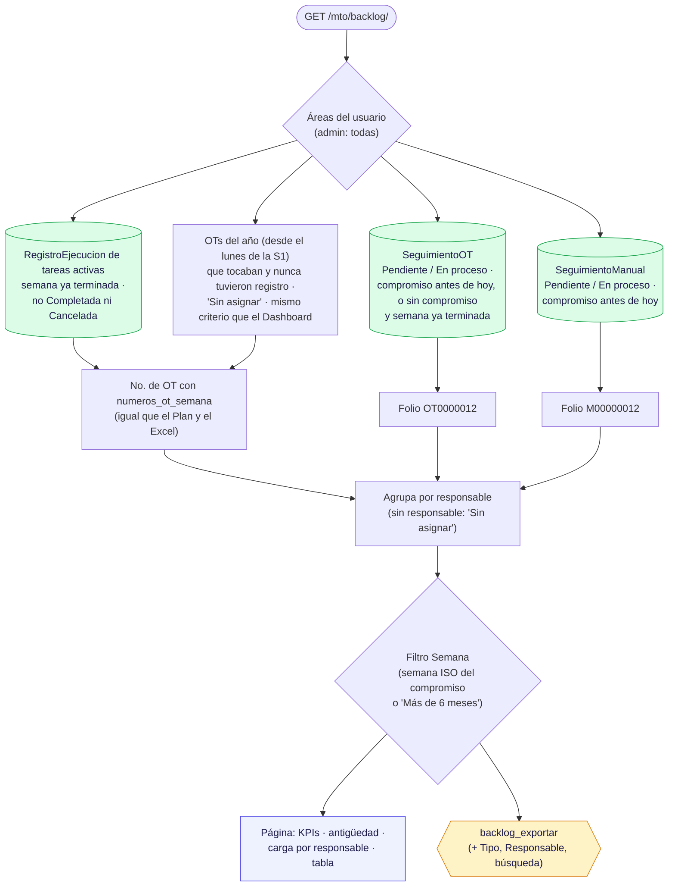

# 2 · Seguimientos, Backlog y Bitácora

**Qué es:** lo que quedó pendiente o se corrigió fuera del Plan: el **Backlog** (órdenes vencidas por responsable),
los **Seguimientos** (correctivos ligados a una OT o manuales) y la **Bitácora** (lo que se hizo en un equipo).
**Quién lo usa y con qué permiso (AccesoMto):** `ver_backlog`; `ver_/llenar_/editar_/validar_/eliminar_seguimiento`;
`ver_/editar_/eliminar_bitacora`.
**Archivos:** `mto_app/views/backlog.py`, `lista_seguimientos.py`, `seguimiento_ot.py`, `seguimiento_manual.py`,
`seguimientos_exportar.py`, `bitacora.py`; plantillas `seguimientos/backlog_seguimientos.html`,
`seguimientos/lista_seguimientos.html`, `bitacora/lista.html`.
**Revisado:** 2026-11-08 — `backlog.py` completo (10 hallazgos corregidos y probados). Seguimientos y Bitácora:
pendiente.

## Diagrama 1 · Qué entra al Backlog (`_datos_backlog`)

## Notas

- **Tres tipos de orden** en una sola lista: OTs del plan con registro pendiente (No. de OT del plan),
  correctivos ligados a una OT (`OT0000012`) y correctivos manuales (`M00000012`).
- **Atraso** = días desde el compromiso (correctivos) o desde el lunes de la semana (OTs).
- **Antigüedad:** 1 semana · 2 semanas · 3 semanas · 1 mes · más de 1 mes (`RANGOS_ANTIGUEDAD`); "Más de 6 meses"
  = más de 180 días (`ATRASO_ALTO`).
- **Vencida** = de una semana que ya terminó (desde el lunes siguiente) o con compromiso ya pasado. Las OTs sin
  registro cuentan desde el lunes de la S1 del año, igual que las "vencidas" del Dashboard: los dos dan el mismo
  número.
- **Tareas desactivadas** no aparecen en el Backlog.

## Hallazgos de la revisión — `backlog.py`

Todos corregidos el 2026-11-08 (`backlog.py` reescrito) y probados: 21 comprobaciones, incluidas fechas simuladas
de cambio de año y que Backlog y Dashboard den el mismo número de OTs sin registro.

| # | Gravedad | Qué pasaba | Corrección |
|---|---|---|---|
| 1 | Alta | Del 1 al 3 de enero de 2027 el Backlog daba **error 500** (`fromisocalendar(2027, 53)` no existe); del 29 al 31 de diciembre de 2025 calculó el lunes de **un año antes**. | ✅ La semana actual es `hoy - días de la semana`. |
| 2 | Media | No pedía **Ver backlog** (ni la página ni la exportación) y armaba sus propias áreas. | ✅ Permiso `ver_backlog` en las dos vistas; áreas con `areas_visibles_mto`. |
| 3 | Media | Un correctivo ligado a una OT con compromiso **futuro** salía vencido con días negativos. | ✅ Vencido solo si el compromiso ya pasó (o, sin compromiso, si su semana ya terminó). |
| 4 | Media | Las OTs vencidas **sin ningún registro** no aparecían (sí en el Dashboard). | ✅ (opción A) Entran las semanas del año sin registro, como "Sin asignar". |
| 5 | Baja | Las OTs de la **semana en curso** contaban como vencidas. | ✅ (opción A) Solo semanas ya terminadas. |
| 6 | Baja | Pendientes de tareas **desactivadas** salían siempre. | ✅ (opción A) Solo tareas activas. |
| 7 | Baja | "Sin asignar" no se traducía. | ✅ `_('Sin asignar')`. |
| 8 | Baja | La página calculaba todo hasta **3 veces**. | ✅ Se calcula una vez (`_ordenes_backlog`) y se filtra en memoria. |
| 9 | Limpieza | Variables sin uso. | ✅ Quitadas; encabezado y docstrings. |
| 10 | Baja | Backlog **y Dashboard** contaban "desde el 1 de enero": cuando la S1 empieza en diciembre (2026 empezó el 29 dic 2025), las OTs de la S1 nunca contaban. | ✅ Los dos empiezan en el lunes de la S1 (`lunes_de_semana(año, 1)`). |

## Hallazgos de la revisión — Seguimientos

Archivos: `seguimiento_ot.py`, `seguimiento_manual.py`, `lista_seguimientos.py`, `seguimientos_exportar.py`
(revisados 2026-11-08). Corregidos y probados el 2026-11-08 (44 comprobaciones; el 9 se aplicó después).

| # | Gravedad | Qué pasaba | Corrección |
|---|---|---|---|
| 1 | Alta | Ninguna acción por id revisaba el área: con el permiso, se creaba, editaba, borraba o validaba un correctivo (de OT o manual) de **cualquier área**, y sus fotos igual. Ver fotos ni pedía permiso. | ✅ `area_visible` y `seguimiento_o_404` (utils): 404 en las 11 acciones. |
| 2 | Alta | `puede_mto` no revisaba `AccesoMto.activo`: con el acceso desactivado los permisos seguían pasando (todo Mantenimiento e Inventario). | ✅ `login_app/permisos.py`. |
| 3 | Media | Un manual creado con "Todas las áreas" quedaba **sin área** y desaparecía de la lista y el Backlog de quien lo creó; el `area_id` del navegador no se validaba. | ✅ (opción A) Área obligatoria: la del filtro si es del usuario, o su única área; si no, pide elegirla (también al admin). |
| 4 | Media | Se podía validar un correctivo de OT no completado. | ✅ Igual que el manual: 400 con mensaje. |
| 5 | Media | Manual sin las validaciones del de OT; mensajes sin traducir; se mostraba el error interno de Python. | ✅ Mismas reglas (`_leer_json`, `_validar`; responsable opcional en el manual). |
| 6 | Media | Fecha inválida en `?fecha_desde=` / `?fecha_hasta=` → **error 500**. | ✅ `_fecha_iso`: se ignora. |
| 7 | Baja | N+1: una consulta de fotos por fila (vista y tarjeta de celular). | ✅ `annotate(n_fotos=Count('imagenes'))`: 12 consultas con 10 o con 50 filas. |
| 8 | Baja | Permisos armados a mano en lista y exportación. | ✅ `puede_mto`. |
| 9 | Baja | "Vencido" en Seguimientos = compromiso **antes** de hoy; en el Backlog = compromiso **hasta** hoy. | ✅ (opción A) El Backlog también usa `< hoy`: un correctivo vence al día siguiente de su compromiso. |
| 10 | Limpieza | El archivo de la foto se borraba dos veces; claves de contexto e import sin uso. | ✅ Lo borra solo la señal. |
| 11 | Baja | La respuesta al crear/editar daba la fecha de creación en UTC (después de las 6 p.m. salía el día siguiente). | ✅ `timezone.localtime`. |

## Pendiente para la revisión del Dashboard
- ✅ Hecho en [06-dashboard-mto.md](06-dashboard-mto.md).

## Hallazgos de la revisión — `bitacora.py` (2026-11-08)

Corregidos y probados el 2026-11-08 (25 comprobaciones con el test client, junto con la otra revisión).

| # | Gravedad | Qué pasa | Estado |
|---|---|---|---|
| 1 | Alta | La **lista** no se limita a las áreas del usuario: sin `?area=` muestra los registros de todas las áreas, y con `?area=` cualquier otra. | ✅ 2026-11-08 |
| 2 | Alta | Editar, eliminar, ver fotos y borrar fotos **por id no revisan el área**; ver fotos ni pide permiso. El formulario de la tabla/celular guarda en el área que llegue en el POST. | ✅ 2026-11-08 |
| 3 | Media | El formulario de la tabla/celular valida menos que el modal: fecha inválida → error interno; acepta fechas futuras y fotos de más de 5 MB. | ✅ 2026-11-08 |
| 4 | Media | `?fecha=abc` o `?area=abc` → **error 500** (lista y exportación). | ✅ 2026-11-08 |
| 5 | Baja | Permisos armados a mano (perfil/acceso, sin revisar acceso activo) y `areas_permitidas_mto`, que deja sin áreas a un administrador sin acceso MTO. | ✅ 2026-11-08 |
| 6 | Baja | Autocompletado de responsables: con `?area_id=` de otra área devuelve sus personas. | ✅ 2026-11-08 |
| 7 | Limpieza | Filtros copiados en la lista y la exportación; la foto se borra dos veces; `getlist` repetido; un error JSON sin traducir. | ✅ 2026-11-08 |
