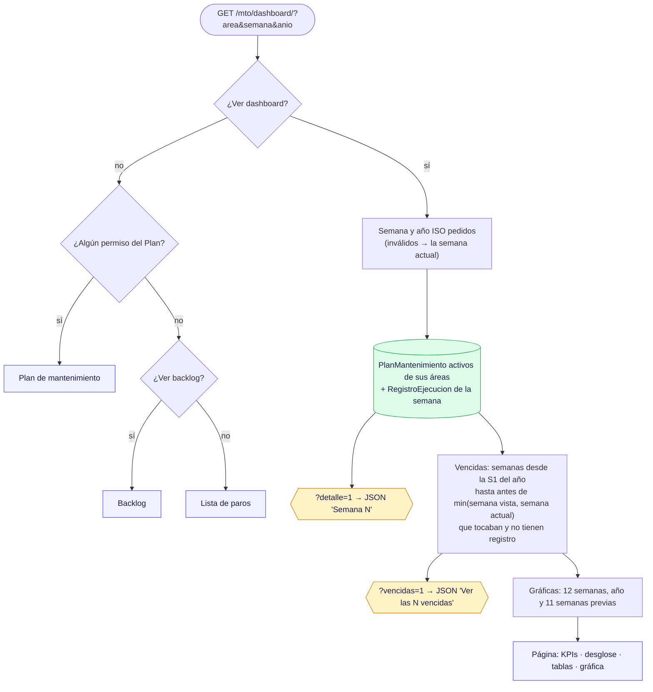

# 6 · Dashboard de mantenimiento

**Qué es:** el resumen de una semana del Plan: cumplimiento contra la meta (90 %), estados de las OTs de la semana,
OTs vencidas sin registro y la gráfica de cumplimiento del año.
**Quién lo usa y con qué permiso (AccesoMto):** `ver_dashboard` (superusuario y administrador siempre). Ve solo sus
áreas (`areas_visibles_mto`); un `?area=` de otra área se ignora.
**Archivos:** `mto_app/views/dashboard.py`; plantilla `mto_app/dashboard.html`; JS `dashboard_escritorio.js` y
`dashboard_movil.js`.
**Revisado:** 2026-11-08 — `dashboard.py` completo (5 hallazgos corregidos y probados).

## Diagrama

## Notas

- **Vencidas** = mismo criterio que las OTs sin registro del Backlog: con la semana actual, los dos dan el mismo
  número. Una semana futura no tiene vencidas por adelantado; una pasada muestra cómo estaba entonces.
- **Pendientes** = sin registro + pendiente (no completada, reagendada ni cancelada).
- **Año ISO:** la semana y el año salen de `hoy.isocalendar()` (del 29 al 31 dic puede ser la S1 del año siguiente;
  del 1 al 3 ene, la S53 del anterior).
- Plan, Backlog, Bitácora, Seguimientos, Inventario y Documentación mandan aquí a quien no tiene su permiso; por eso
  el Dashboard nunca regresa a una de ellas sin revisar ese permiso (no hay ciclo).

## Hallazgos de la revisión — `dashboard.py`

| # | Gravedad | Qué pasaba | Corrección |
|---|---|---|---|
| 1 | Alta | Usaba `hoy.year` y no el año ISO: del 1 al 3 ene 2027 **error 500**; del 29 al 31 dic 2025 abría la S1 **de 2025**. | ✅ `hoy.isocalendar()`. |
| 2 | Media | `?semana=abc` / `?anio=0` daban **500**; con una semana que el año no tiene, mezclaba la semana actual con el año pedido. | ✅ Semana y año se validan juntos (año 2000-2100); si no, la semana actual. |
| 3 | Media | No pedía **Ver dashboard** (el menú lo ocultaba, la URL no). | ✅ (opción A) Mensaje y a Plan → Backlog → Paros. |
| 4 | Baja | Al ver una semana futura, las semanas que aún no terminaban contaban como vencidas. | ✅ (opción A) Hasta `min(semana vista, semana actual)`. |
| 5 | Limpieza | Import `Area`, alias, `tipos` y claves del contexto sin uso; la S1 se calculaba en cada vuelta. | ✅ Quitados; `inicio_anio` una vez. |

**Pendiente (opcional):** la gráfica de descarga (`cumplimiento_semanas`…) recalcula las 53 semanas que `serie_anio`
ya tiene.
