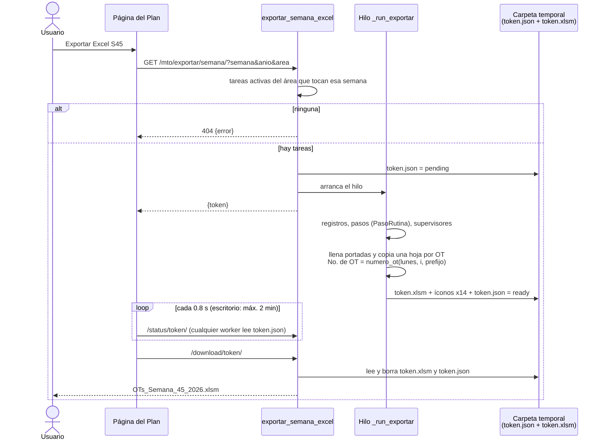

# Proceso · Exportar Excel de la semana

**Qué es:** el `.xlsm` con las órdenes de trabajo de una semana del Plan: 1-2 hojas de portada con la lista y una
hoja por OT (datos de la tarea, pasos de la rutina con sus puntos críticos y quién la ejecuta).
**Quién lo usa y con qué permiso:** botón **Exportar Excel S##** del Plan (escritorio) y hoja **⋯** (móvil); algún
permiso del Plan (`puede_ver_plan`), solo de su área (`area_del_plan`). Solo quien inicia la exportación puede
consultarla y descargarla.
**Archivos:** `mto_app/views/exportacion.py`; plantilla `mto_app/static/mto_app/Week Format.xlsm`;
JS `plan_escritorio.js` (escritorio) y `overlay_exportar.js` (móvil).
**Revisado:** 2026-11-08 — `exportacion.py` completo.

## Diagrama

## Notas

- **Por qué un hilo y archivos:** generar el Excel tarda; con `gunicorn --workers 3` el estado se guarda en la
  carpeta temporal para que cualquier proceso conteste `status` y `download`. Los trabajos de más de 6 h se borran.
- **No. de OT** igual que el Plan, el Backlog y el formulario: se numeran las tareas del área en el orden del modelo
  (área, locación, actividad, código).
- **Íconos ▼ ● ▲** de puntos críticos: openpyxl borra el formato condicional x14 de la plantilla; se lee de la
  plantilla y se vuelve a poner en cada hoja (`_iconos_plantilla`, `_poner_iconos`).
- **Supervisor (I7):** el primer responsable activo del área con "supervisor" en la posición; si no hay, quien exporta.
- **Portadas:** 42 OTs en la 1 y 84 en la 2; si una semana tiene más de 126, las demás tienen su hoja pero no salen
  en la portada.
- Textos del Excel en español (la plantilla es en español).

## Hallazgos de la revisión — `exportacion.py`

Todos corregidos el 2026-11-08 y probados (20 comprobaciones con el test client; el Excel se genera, se descarga y
se abre).

| # | Gravedad | Qué pasaba | Corrección |
|---|---|---|---|
| 1 | Alta | Solo pedía sesión: cualquier usuario (incluso solo de Paros) exportaba cualquier área con `?area=`, y **sin `?area=` exportaba todas las áreas juntas** con un consecutivo corrido (No. de OT distintos al Plan). | ✅ `puede_ver_plan` (403) y el área sale de `area_del_plan`: siempre una sola área del usuario. |
| 2 | Media | `?semana=abc` o la S53 de un año que no la tiene daban **error 500**. | ✅ 400 "Semana no válida." |
| 3 | Media | Si el worker se reiniciaba a media exportación, el trabajo quedaba "pending" para siempre (en móvil la espera **nunca terminaba**). | ✅ El estado guarda `inicio`; con más de 180 s en "pending", `status` regresa error. |
| 4 | Baja | `status` y `download` no revisaban que el trabajo fuera de quien pregunta. | ✅ El estado guarda `usuario` (`_trabajo_del_usuario`). |
| 5 | Baja | Doble clic en la descarga o archivo ya borrado → **error 500**. | ✅ Mensaje y regreso al Plan. |
| 6 | Baja | El hilo dejaba abierta su conexión a la base de datos. | ✅ `connection.close()` al terminar. |
| 7 | Baja | Móvil (`overlay_exportar.js`): textos fijos en español y sin límite de espera. | ✅ Textos de `PE_I18N` y máximo 2 min, igual que escritorio. |
