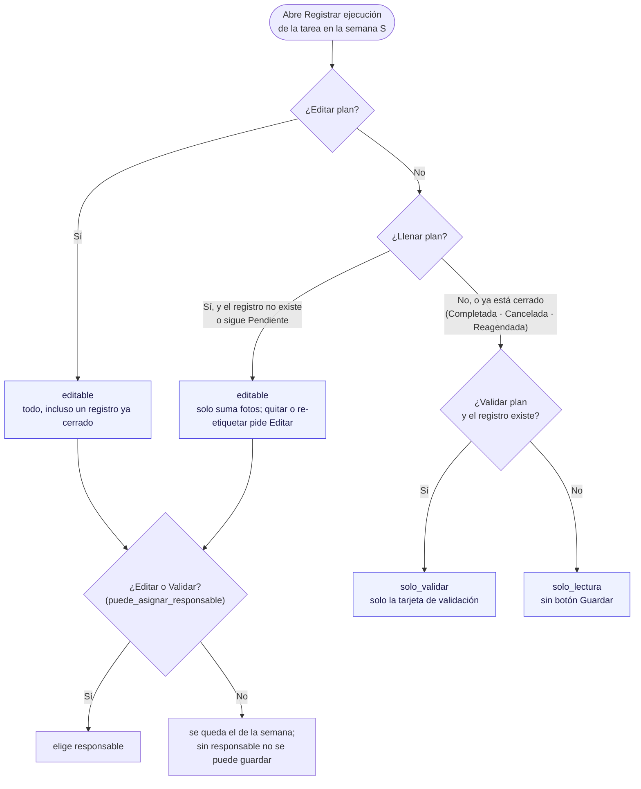
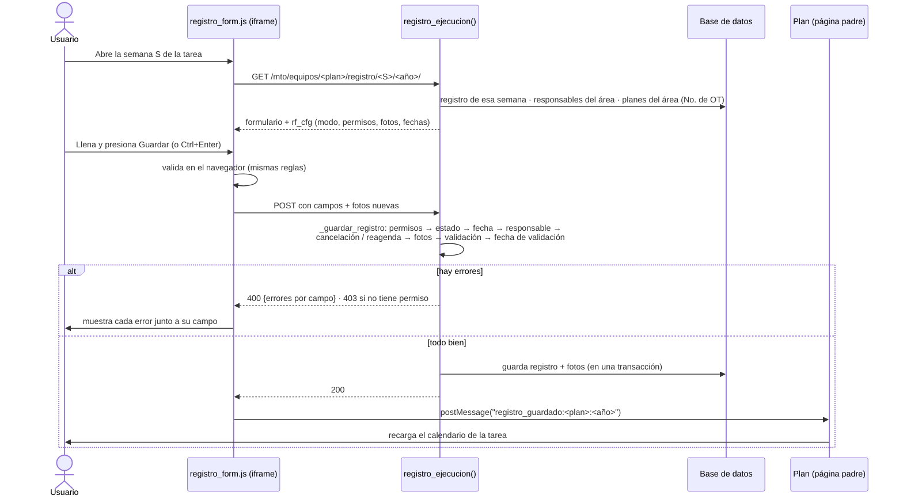

# Proceso · Registrar y validar una OT

**Qué es:** cómo se llena la ejecución semanal de una tarea del plan (estado, responsable, fecha, observaciones,
fotos) y cómo se valida o rechaza. Un registro = una tarea en una semana (`RegistroEjecucion`, único por plan y lunes).
**Quién lo usa y con qué permiso (AccesoMto):** `llenar_plan_mantenimiento`, `editar_plan_mantenimiento`,
`validar_plan_mantenimiento`, `eliminar_plan_mantenimiento`; la fecha de validación solo la corrige superusuario o
administrador (`es_admin`).
**Archivos:** `mto_app/views/registro_ejecucion.py`, `templates/mto_app/plan/registro_form.html` (página dentro de un
`<iframe>` del detalle del plan), `static/mto_app/js/registro_form.js`; en celular `static/mto_app/js/plan_movil.js`
manda el mismo POST.
**Revisado:** 2026-11-08 — `registro_ejecucion.py` completo.

## Diagrama 1 · Qué puede hacer cada quien en el formulario

`permisos_registro()` decide el modo; el servidor lo vuelve a aplicar al guardar aunque el navegador se salte la interfaz.

## Diagrama 2 · Guardar (paso a paso)

## Diagrama 3 · Estados de la validación

```mermaid
stateDiagram-v2
    [*] --> PorValidar: se crea el registro
    PorValidar --> Validado: Validar · solo si está Completada ·<br/>elige "Validado por" · guarda fecha y usuario
    PorValidar --> Rechazado: Validar · con motivo
    Rechazado --> PorValidar: se vuelve a completar
    Validado --> PorValidar: cambia el estado, la fecha de ejecución<br/>o las fotos (aviso "la validación se reiniciará")
    Validado --> PorValidar: un validador lo regresa
    Validado --> Validado: administrador corrige la fecha de validación<br/>(solo el día; conserva la hora)
    note right of Rechazado
        Un rechazo reabre el registro:
        su estado vuelve a Pendiente.
    end note
```

## Notas

- **Un registro por tarea y semana** (`unique_together = plan + semana_inicio`). Se crea al guardar por primera vez o
  al asignar responsable desde la lista del Plan (`asignar_responsable`).
- **Cerrado** = Completada, Cancelada o Reagendada. Quien solo tiene *Llenar* ya no puede modificarlo.
- **Atraso:** si la fecha de ejecución cae después de la semana programada, se guarda `semanas_atraso` (semanas
  completas entre los dos lunes).
- **Nombres congelados:** el registro guarda el nombre del responsable y del validador como estaban al asignarlos;
  editar la ficha de la persona no cambia registros anteriores.
- **No. de OT** en la etiqueta del formulario: el mismo que el Plan, el Backlog y el Excel (ver
  [numero-ot.md](numero-ot.md)); vacío si la semana no calza con la frecuencia.
- **Fotos:** máximo 4, JPG o PNG reales de hasta 5 MB (se revisa el contenido, no solo el tipo que dice el
  navegador); se guardan con un nombre nuevo y se comprimen (`ImagenRegistro.save`).
- **Acceso:** el formulario solo se abre para tareas de las áreas del usuario y con algún permiso del Plan;
  superusuario y administrador ven todas las áreas.

## Hallazgos de la revisión

Todos corregidos el 2026-11-08 y probados (34 comprobaciones de servidor + formulario real en el navegador).

| # | Gravedad | Qué pasaba | Corrección |
|---|---|---|---|
| 1 | Alta | Las fotos solo se validaban por el tipo que declara el navegador: se podía subir un archivo que no es imagen (p. ej. `.html`) y quedaba servido desde `/media/`. | ✅ `paros_app.models.imagen_subida_valida()` lee el contenido con Pillow, solo acepta JPG/PNG reales y renombra el archivo con su extensión verdadera. Aplicada también en las otras 8 subidas de fotos del proyecto (paros, bitácora, seguimientos, inventario) y probada en todas. |
| 2 | Media | Las 3 vistas no revisaban el área del usuario ni el permiso del Plan: cualquiera con sesión abría el formulario de cualquier área, y con permisos de mantenimiento guardaba, eliminaba o asignaba en áreas ajenas. | ✅ `_puede_ver()`: algún permiso del Plan (Ver, Llenar, Editar o Validar) y el área en `areas_visibles_mto`. Abrir → "No tienes acceso a las tareas de esta área."; guardar, eliminar o asignar → 403. |
| 3 | Media | `asignar_responsable` aceptaba personas de otra área o inactivas; un id inválido quitaba al responsable sin avisar; no registraba quién hizo el cambio. | ✅ Usa `_responsable_valido` (400 si no es válida, sin tocar lo que había) y guarda `modificado_por`. |
| 4 | Baja | Quien no puede validar podía cambiar "Validado por" de un registro validado mandando otro id. | ✅ Sin permiso de Validar se conserva el validador guardado. |
| 5 | Baja | Semana o año imposibles en la URL daban error 500. | ✅ `_lunes_o_404()` responde 404. |
| 6 | Baja | Reagendar aceptaba la semana 53 en años que no la tienen. | ✅ Se valida contra la última semana ISO del año (y año 2000–2100). |
| 7 | Baja | Un rechazo dejaba el registro en Pendiente pero conservaba `semanas_atraso`. | ✅ El atraso se calcula con el estado que realmente se guarda (`estado_final`). |
